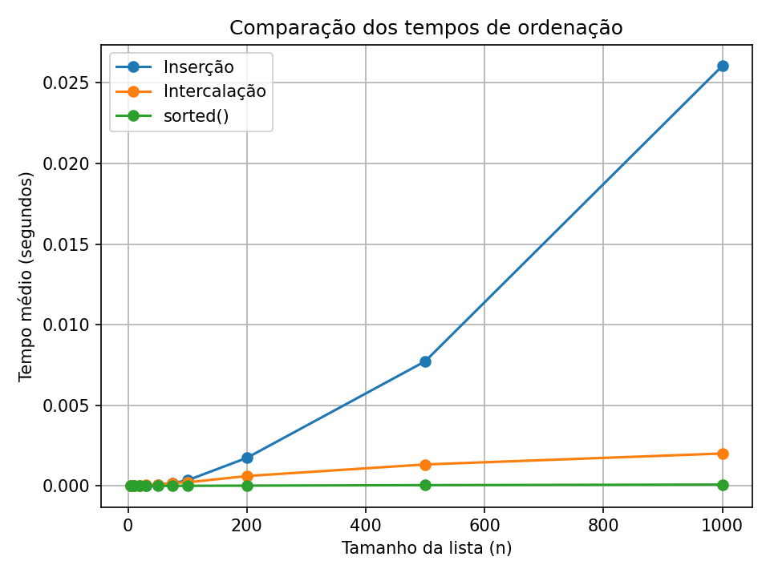
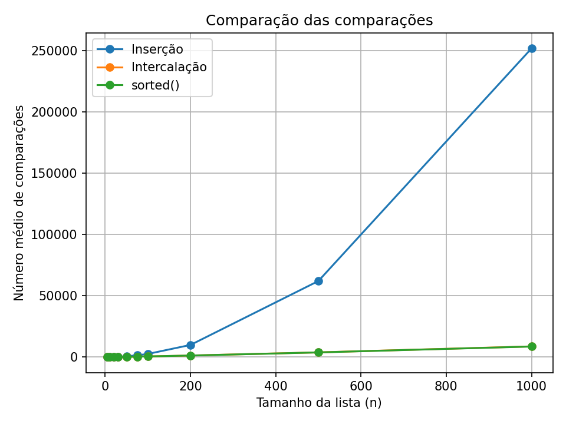

# Relatório: Comparação de Algoritmos de Ordenação

## 1. Objetivo

O objetivo deste trabalho é implementar e comparar dois algoritmos de ordenação — ordenação por inserção (Insertion Sort) e ordenação por intercalação (Merge Sort) — e comparar seus resultados com a função `sorted()` do Python. Foram observados o tempo médio de execução e o número médio de comparações.

## 2. Metodologia

Foram utilizadas listas aleatórias com os tamanhos 5, 10, 20, 30, 50, 75, 100, 200, 500 e 1000. Para cada tamanho, foram realizadas 10 repetições, usando uma lista aleatória em cada repetição. Os resultados apresentados são médias dessas repetições.

O tempo foi medido com `time.perf_counter()`. As comparações dos algoritmos implementados foram contadas durante suas execuções. Para o extra, as comparações de `sorted()` foram contadas com uma classe que implementa o método `__lt__`.

Os tempos são apresentados em segundos. Como as listas pequenas são ordenadas muito rapidamente, pequenas diferenças de tempo podem ser causadas pelo custo de medição e por variações normais da execução.

## 3. Tabela de tempos médios

| n | Inserção (s) | Intercalação (s) | `sorted()` (s) |
|---:|---:|---:|---:|
| 5 | 0.00000255 | 0.00000694 | 0.00000091 |
| 10 | 0.00000670 | 0.00001805 | 0.00000128 |
| 20 | 0.00001451 | 0.00002971 | 0.00000131 |
| 30 | 0.00003142 | 0.00005005 | 0.00000209 |
| 50 | 0.00008105 | 0.00007892 | 0.00000338 |
| 75 | 0.00017622 | 0.00018841 | 0.00000636 |
| 100 | 0.00034911 | 0.00022545 | 0.00000885 |
| 200 | 0.00174166 | 0.00061445 | 0.00002090 |
| 500 | 0.00773070 | 0.00133362 | 0.00005034 |
| 1000 | 0.02604951 | 0.00201173 | 0.00008541 |

## 4. Tabela de comparações médias

| n | Inserção | Intercalação | `sorted()` |
|---:|---:|---:|---:|
| 5 | 7.2 | 7.0 | 7.9 |
| 10 | 29.8 | 22.6 | 23.1 |
| 20 | 110.4 | 63.0 | 62.8 |
| 30 | 238.2 | 110.9 | 110.4 |
| 50 | 684.3 | 221.4 | 217.1 |
| 75 | 1450.4 | 375.4 | 369.4 |
| 100 | 2578.8 | 544.8 | 534.4 |
| 200 | 9920.7 | 1278.1 | 1266.6 |
| 500 | 62074.1 | 3854.6 | 3822.2 |
| 1000 | 251887.1 | 8717.2 | 8628.3 |

## 5. Gráfico dos tempos



O gráfico compara o tempo médio de execução dos três métodos. A função `sorted()` apresentou o menor tempo em todos os tamanhos medidos. Entre os dois algoritmos implementados, a intercalação apresentou vantagem clara nos tamanhos maiores.

## 6. Gráfico das comparações



O gráfico mostra que o número de comparações da inserção cresce rapidamente à medida que o tamanho da lista aumenta. A intercalação e `sorted()` apresentaram números de comparações próximos e bem menores que a inserção nos tamanhos maiores.

## 7. Análise dos resultados

### Em qual tamanho a intercalação passa a ser mais rápida?

Nos dados obtidos, a inserção foi ligeiramente mais rápida em n = 5, 10, 20 e 30. Em n = 50, a intercalação foi apenas um pouco mais rápida (0,000079 s contra 0,000081 s), mas em n = 75 a inserção voltou a ser ligeiramente mais rápida. A partir de n = 100, a intercalação foi mais rápida em todos os tamanhos medidos: 100, 200, 500 e 1000.

Portanto, não há um ponto de virada perfeitamente estável nos tamanhos pequenos, pois as diferenças são muito pequenas. Nesta medição, **n = 100 é o primeiro tamanho a partir do qual a intercalação se manteve mais rápida nos tamanhos testados**.

### O gráfico de comparações e o de tempo dão o mesmo ponto de virada?

Não exatamente. A quantidade de comparações da intercalação já é menor que a da inserção em n = 5, enquanto o tempo da intercalação só se torna consistentemente menor nos tamanhos maiores. Isso ocorre porque o tempo não depende apenas das comparações: também existem custos de chamadas de funções, criação de sublistas, cópias, atribuições e execução do próprio Python. Em listas pequenas, esses custos podem ser tão importantes quanto o número de comparações.

### Por que a comparação com `sorted()` não serve para decidir entre os dois algoritmos?

`sorted()` é uma função pronta e altamente otimizada do Python, que utiliza o algoritmo Timsort. Sua implementação tem custos e otimizações diferentes dos algoritmos escritos neste trabalho. Assim, o fato de `sorted()` ser mais rápido não permite concluir que um dos dois algoritmos estudados seja sempre melhor em qualquer situação; a comparação serve como referência de desempenho da função padrão da linguagem.

### Um caso em que a inserção ainda seria uma escolha adequada

A ordenação por inserção pode ser uma boa escolha para listas pequenas ou quase ordenadas. Ela é simples de implementar e, quando os elementos já estão próximos de suas posições finais, pode realizar poucas comparações e movimentações. Também pode ser útil em implementações híbridas de ordenação, nas quais listas pequenas são tratadas com inserção.

## 8. Extra: comparações de `sorted()`

As comparações foram contadas por meio de uma classe que registra cada chamada de `__lt__`, operador usado para comparar objetos com `<`. Nos dados medidos, o número de comparações de `sorted()` ficou próximo ao da intercalação e muito abaixo do da inserção para listas maiores.

O limite de referência discutido em aula é da ordem de `n log n` para algoritmos de ordenação por comparação eficientes no caso geral. Os resultados são compatíveis com um crescimento muito menor que o crescimento quadrático observado na inserção para listas aleatórias maiores. O número exato de comparações de `sorted()` pode variar conforme a ordem dos dados, pois o Timsort aproveita sequências já ordenadas.

## 9. Como reproduzir os resultados

Com Python instalado e a biblioteca `matplotlib`, execute:

```bash
python testes.py
python medir.py
```

O comando `python medir.py` recria o arquivo `dados.csv` e os gráficos `tempos.png` e `comparacoes.png`. As medições podem apresentar pequenas diferenças em computadores e execuções diferentes.
